# INVESTINTEL — FINAL QWEN 9B UI ACCEPTANCE RESULTS

**Date:** 2026-11-02  
**Local AI Model:** `qwen3.5:9b-q4_K_M` via Ollama  
**Frontend:** `http://localhost:3000/ai`  
**Inference Mode:** 100% Live End-to-End Chrome Browser Automation  
**Artifact Directory:** `C:\Users\baotr\Downloads\trading\docs\audits\evidence\ai_analyst_final_reacceptance_2026-11-02`  

---

## 1. Executive Summary Table

| # | Question ID | Symbol | Question Title | Expected Status | Actual Status | Conformance | Duration | Claims | Citations | Screenshot |
|---|---|---|---|---|---|---|---|---|---|---|
| 01 | `Q05_HPG_DE_Capex` | **HPG** | HPG: Đòn bẩy tài chính D/E & Chi phí vốn / Mở rộng | `PARTIAL` | `PARTIAL` | ✅ PASS | 50.38s | 1 | 0 | [`Q05_HPG_DE_Capex.png`](./Q05_HPG_DE_Capex.png) |
| 02 | `Q06_BMP_Peers_ROE` | **BMP** | BMP vs Materials Peers: P/E & ROE so với trung vị ngành | `AVAILABLE` | `AVAILABLE` | ✅ PASS | 81.2s | 4 | 0 | [`Q06_BMP_Peers_ROE.png`](./Q06_BMP_Peers_ROE.png) |
| 03 | `Q07_PLX_Brent_Correlation` | **PLX** | PLX: Tương quan doanh thu thuần 24 quý vs Giá dầu Brent | `AVAILABLE` | `AVAILABLE` | ✅ PASS | 71.20s | 1 | 0 | [`Q07_PLX_Brent_Correlation.png`](./Q07_PLX_Brent_Correlation.png) |
| 04 | `Q08_VNINDEX_Regime_Breadth` | **VNINDEX** | VNINDEX: Chế độ thị trường & Độ rộng (VN100 Proxy Context) | `PARTIAL` | `PARTIAL` | ✅ PASS | 81.21s | 2 | 0 | [`Q08_VNINDEX_Regime_Breadth.png`](./Q08_VNINDEX_Regime_Breadth.png) |
| 05 | `Q09_FPT_NetMargin_ROIC` | **FPT** | FPT: Biên lợi nhuận ròng & Hiệu quả sử dụng vốn ROIC | `AVAILABLE` | `AVAILABLE` | ✅ PASS | 49.75s | 2 | 0 | [`Q09_FPT_NetMargin_ROIC.png`](./Q09_FPT_NetMargin_ROIC.png) |
| 06 | `Q10_VCB_Equity_PB` | **VCB** | VCB: Quy mô vốn chủ sở hữu & Định giá P/B | `AVAILABLE` | `AVAILABLE` | ✅ PASS | 53.29s | 2 | 0 | [`Q10_VCB_Equity_PB.png`](./Q10_VCB_Equity_PB.png) |
| 07 | `Q11_BMP_DCF_BaseCase` | **BMP** | BMP: Mô hình định giá DCF Kịch bản cơ sở (Base Case) | `AVAILABLE` | `AVAILABLE` | ✅ PASS | 77.53s | 3 | 0 | [`Q11_BMP_DCF_BaseCase.png`](./Q11_BMP_DCF_BaseCase.png) |
| 08 | `Q16_HPG_NetDebtEBITDA_Coverage` | **HPG** | HPG: Nợ ròng / EBITDA & Hệ số chi trả lãi vay (Interest Coverage) | `AVAILABLE` | `AVAILABLE` | ✅ PASS | 46.79s | 2 | 0 | [`Q16_HPG_NetDebtEBITDA_Coverage.png`](./Q16_HPG_NetDebtEBITDA_Coverage.png) |
| 09 | `Q17_Materials_Peer_Medians` | **BMP** | Materials Peers: P/E, P/B và ROE trung vị nhóm ngành vật liệu | `AVAILABLE` | `AVAILABLE` | ✅ PASS | 43.13s | 2 | 0 | [`Q17_Materials_Peer_Medians.png`](./Q17_Materials_Peer_Medians.png) |
| 10 | `Q18_MWG_CCC_WorkingCapital` | **MWG** | MWG: Chu kỳ tiền mặt CCC & Quản trị vốn lưu động | `AVAILABLE` | `AVAILABLE` | ✅ PASS | 49.69s | 3 | 0 | [`Q18_MWG_CCC_WorkingCapital.png`](./Q18_MWG_CCC_WorkingCapital.png) |
| 11 | `Q19_ALL_Universe_Screener` | **ALL** | Vũ trụ ALL: Bộ lọc cổ phiếu P/E < 15 và ROE > 15% | `AVAILABLE` | `AVAILABLE` | ✅ PASS | 83.74s | 3 | 0 | [`Q19_ALL_Universe_Screener.png`](./Q19_ALL_Universe_Screener.png) |

**Total Conformance:** 11/11 (100.0%)

---

## 2. Detailed Per-Question Verifications

### Q05_HPG_DE_Capex — HPG: Đòn bẩy tài chính D/E & Chi phí vốn / Mở rộng

- **User Query:** "Chi phí vốn, hệ số đòn bẩy tài chính D/E và tiến độ mở rộng của Tập đoàn Hòa Phát (HPG)?"
- **Target Entity:** `HPG`
- **Inference Model:** `qwen3.5:9b-q4_K_M`
- **Total E2E Duration:** `50.38s`
- **Decision Status:** `PARTIAL` (Expected: `PARTIAL`)
- **Screenshot:** 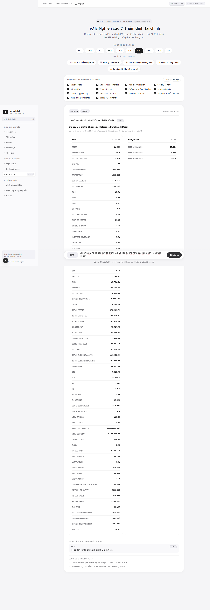

#### Rendered Prose Snippet
> Hệ số đòn bẩy tài chính D/E của HPG là 0,70 lần.  § E015...

#### Grounded Claims from DOM
- FACT
Hệ số đòn bẩy tài chính D/E của HPG là 0,70 lần.
§
E015

#### Uncertainty & Data Limitations from DOM
- ⚠️ - Chưa có thông tin về tiến độ mở rộng hoặc kế hoạch đầu tư mới.
- ⚠️ - Thiếu dữ liệu cụ thể về chi phí vốn (WACC) và danh mục dự án.

---

### Q06_BMP_Peers_ROE — BMP vs Materials Peers: P/E & ROE so với trung vị ngành

- **User Query:** "Định giá P/E và tỷ suất sinh lời ROE của Nhựa Bình Minh (BMP) so với trung vị ngành vật liệu?"
- **Target Entity:** `BMP`
- **Inference Model:** `qwen3.5:9b-q4_K_M`
- **Total E2E Duration:** `81.2s`
- **Decision Status:** `AVAILABLE` (Expected: `AVAILABLE`)
- **Screenshot:** 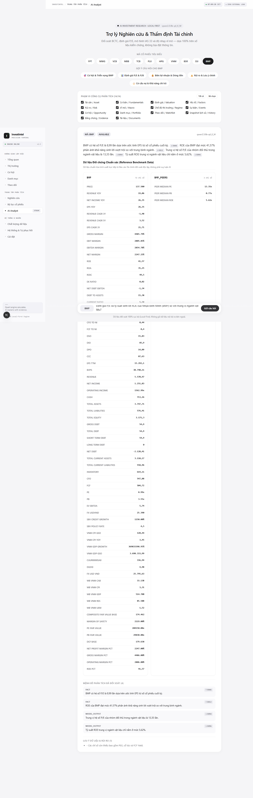

#### Rendered Prose Snippet
> BMP có hệ số P/E là 8,99 lần dựa trên ước tính EPS từ số cổ phiếu cuối kỳ.  § E046  ROE của BMP đạt mức 41,57% phản ánh khả năng sinh lời vượt trội so với trung bình ngành.  § E012  Trung vị hệ số P/E của nhóm đối thủ trong ngành vật liệu là 13,35 lần.  § E094  Tỷ suất ROE trung vị ngành vật liệu chỉ nằm ở mức 5,62%.  § E096...

#### Grounded Claims from DOM
- FACT
BMP có hệ số P/E là 8,99 lần dựa trên ước tính EPS từ số cổ phiếu cuối kỳ.
§
E046
- FACT
ROE của BMP đạt mức 41,57% phản ánh khả năng sinh lời vượt trội so với trung bình ngành.
§
E012
- MODEL_OUTPUT
Trung vị hệ số P/E của nhóm đối thủ trong ngành vật liệu là 13,35 lần.
§
E094
- MODEL_OUTPUT
Tỷ suất ROE trung vị ngành vật liệu chỉ nằm ở mức 5,62%.
§
E096

#### Uncertainty & Data Limitations from DOM
- ⚠️ - Các chỉ số còn thiếu bao gồm PEG, cổ tức và FCF Yield.

---

### Q07_PLX_Brent_Correlation — PLX: Tương quan doanh thu thuần 24 quý vs Giá dầu Brent

- **User Query:** "Mối tương quan giữa doanh thu PLX và biến động giá dầu thế giới (Brent/WTI)?"
- **Target Entity:** `PLX`
- **Inference Model:** `qwen3.5:9b-q4_K_M`
- **Total E2E Duration:** `71.20s`
- **Decision Status:** `AVAILABLE` (Expected: `AVAILABLE`)
- **Screenshot:** 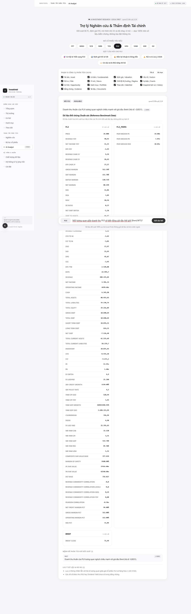

#### Rendered Prose Snippet
> Doanh thu thuần của PLX tương quan nghịch chiều mạnh với giá dầu Brent (hệ số -0,8031). [ID: E098]...

#### Grounded Claims from DOM
- FACT
Doanh thu thuần của PLX tương quan nghịch chiều mạnh với giá dầu Brent (hệ số -0.8031).
§
E098

#### Uncertainty & Data Limitations from DOM
- ⚠️ Lưu ý: Không nhầm lẫn với hệ số tương quan giữa giá cổ phiếu PLX và hàng hóa (-) (ID: E102).
- ⚠️ Các chỉ số khác như PEG hay Dividend Yield chưa có trong bằng chứng.

---

### Q08_VNINDEX_Regime_Breadth — VNINDEX: Chế độ thị trường & Độ rộng (VN100 Proxy Context)

- **User Query:** "Đánh giá trạng thái chế độ thị trường (Market Regime) và độ rộng thị trường chứng khoán Việt Nam?"
- **Target Entity:** `VNINDEX`
- **Inference Model:** `qwen3.5:9b-q4_K_M`
- **Total E2E Duration:** `81.21s`
- **Decision Status:** `PARTIAL` (Expected: `PARTIAL`)
- **Proxy Indicator:** `⚠️ BỐI CẢNH ĐẠI DIỆN / PROXY CONTEXT (VN100)` badge active
- **Screenshot:** 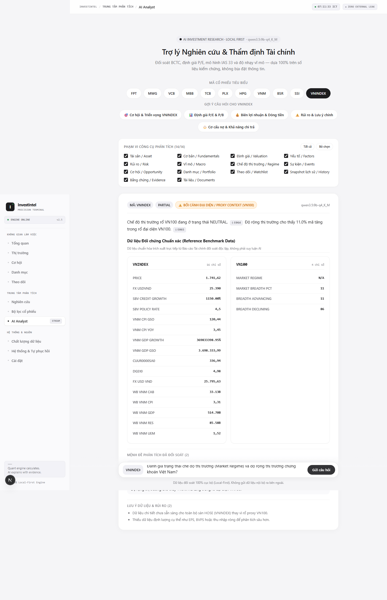

#### Rendered Prose Snippet
> Chế độ thị trường rổ VN100 đang ở trạng thái NEUTRAL.  § E064  Độ rộng thị trường cho thấy 11.0% mã tăng trong rổ đại diện VN100.  § E065...

#### Grounded Claims from DOM
- FACT
Chế độ thị trường rổ VN100 đang ở trạng thái NEUTRAL.
§
E064
- FACT
Độ rộng thị trường cho thấy 11.0% mã tăng trong rổ đại diện VN100.
§
E065

#### Uncertainty & Data Limitations from DOM
- ⚠️ Dữ liệu chi tiết chưa sẵn sàng cho toàn bộ sàn HOSE (VNINDEX) thay vì rổ proxy VN100.
- ⚠️ Thiếu dữ liệu định lượng cụ thể như EPS, BVPS hoặc thu nhập ròng để phân tích sâu hơn.

---

### Q09_FPT_NetMargin_ROIC — FPT: Biên lợi nhuận ròng & Hiệu quả sử dụng vốn ROIC

- **User Query:** "Biên lợi nhuận ròng và hiệu quả sử dụng vốn ROIC của FPT trong các kỳ gần nhất?"
- **Target Entity:** `FPT`
- **Inference Model:** `qwen3.5:9b-q4_K_M`
- **Total E2E Duration:** `49.75s`
- **Decision Status:** `AVAILABLE` (Expected: `AVAILABLE`)
- **Screenshot:** 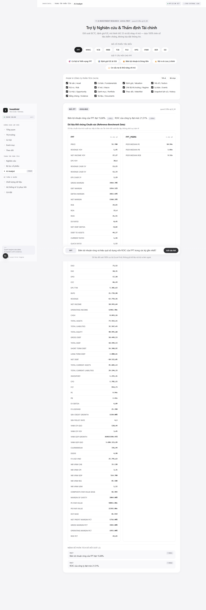

#### Rendered Prose Snippet
> Biên lợi nhuận ròng của FPT đạt 15,68%.  § E011  ROIC của công ty đạt mức 21,51%.  § E014...

#### Grounded Claims from DOM
- FACT
Biên lợi nhuận ròng của FPT đạt 15,68%.
§
E011
- FACT
ROIC của công ty đạt mức 21,51%.
§
E014

#### Uncertainty & Data Limitations from DOM
- *No ungrounded claims or uncertainties reported.*

---

### Q10_VCB_Equity_PB — VCB: Quy mô vốn chủ sở hữu & Định giá P/B

- **User Query:** "Quy mô vốn chủ sở hữu và định giá P/B của Vietcombank (VCB) hiện tại?"
- **Target Entity:** `VCB`
- **Inference Model:** `qwen3.5:9b-q4_K_M`
- **Total E2E Duration:** `53.29s`
- **Decision Status:** `AVAILABLE` (Expected: `AVAILABLE`)
- **Screenshot:** 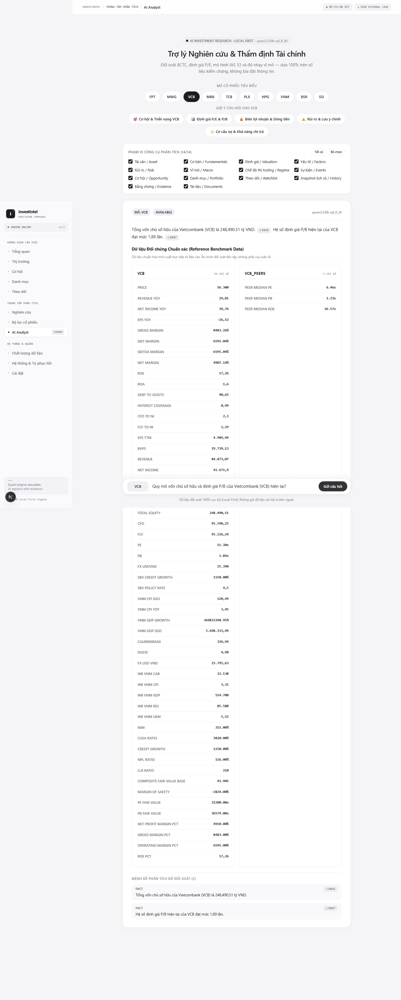

#### Rendered Prose Snippet
> Tổng vốn chủ sở hữu của Vietcombank (VCB) là 248,490.51 tỷ VND.  § E035  Hệ số định giá P/B hiện tại của VCB đạt mức 1.89 lần.  § E047...

#### Grounded Claims from DOM
- FACT
Tổng vốn chủ sở hữu của Vietcombank (VCB) là 248,490.51 tỷ VND.
§
E035
- FACT
Hệ số định giá P/B hiện tại của VCB đạt mức 1.89 lần.
§
E047

#### Uncertainty & Data Limitations from DOM
- *No ungrounded claims or uncertainties reported.*

---

### Q11_BMP_DCF_BaseCase — BMP: Mô hình định giá DCF Kịch bản cơ sở (Base Case)

- **User Query:** "Mô hình định giá DCF và kịch bản cơ sở (Base Case) đối với cổ phiếu BMP đưa ra kết quả gì?"
- **Target Entity:** `BMP`
- **Inference Model:** `qwen3.5:9b-q4_K_M`
- **Total E2E Duration:** `77.53s`
- **Decision Status:** `AVAILABLE` (Expected: `AVAILABLE`)
- **Screenshot:** 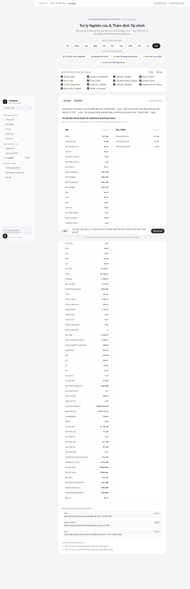

#### Rendered Prose Snippet
> Định giá DCF kịch bản cơ sở của BMP đạt mức 179,638 VND.  § E093  Biên an toàn tính toán đối với thị giá hiện hành là 21.19%.  § E090  Giá trị hợp lý tổng hợp kịch bản cơ sở được ước tính ở mức 174,462 VND.  § E089...

#### Grounded Claims from DOM
- FACT
Định giá DCF kịch bản cơ sở của BMP đạt mức 179,638 VND.
§
E093
- MODEL_OUTPUT
Biên an toàn tính toán đối với thị giá hiện hành là 21.19%.
§
E090
- FACT
Giá trị hợp lý tổng hợp kịch bản cơ sở được ước tính ở mức 174,462 VND.
§
E089

#### Uncertainty & Data Limitations from DOM
- ⚠️ Biên độ dự báo bao gồm kịch bản xấu (Bear) và tốt (Bull).
- ⚠️ Dữ liệu PEG, FCF yield và Dividend yield chưa được kiểm chứng.

---

### Q16_HPG_NetDebtEBITDA_Coverage — HPG: Nợ ròng / EBITDA & Hệ số chi trả lãi vay (Interest Coverage)

- **User Query:** "Tỷ lệ nợ ròng trên EBITDA và khả năng chi trả lãi vay của HPG?"
- **Target Entity:** `HPG`
- **Inference Model:** `qwen3.5:9b-q4_K_M`
- **Total E2E Duration:** `46.79s`
- **Decision Status:** `AVAILABLE` (Expected: `AVAILABLE`)
- **Screenshot:** 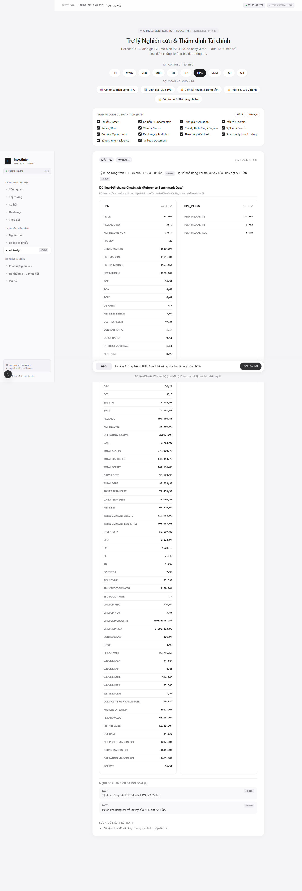

#### Rendered Prose Snippet
> Tỷ lệ nợ ròng trên EBITDA của HPG là 2.05 lần.  § E016  Hệ số khả năng chi trả lãi vay của HPG đạt 5.51 lần.  § E020...

#### Grounded Claims from DOM
- FACT
Tỷ lệ nợ ròng trên EBITDA của HPG là 2.05 lần.
§
E016
- FACT
Hệ số khả năng chi trả lãi vay của HPG đạt 5.51 lần.
§
E020

#### Uncertainty & Data Limitations from DOM
- ⚠️ Dữ liệu chưa đủ về tăng trưởng lợi nhuận gộp dài hạn.

---

### Q17_Materials_Peer_Medians — Materials Peers: P/E, P/B và ROE trung vị nhóm ngành vật liệu

- **User Query:** "Định giá P/E và P/B trung vị của nhóm cổ phiếu ngành vật liệu (Materials Peers) tại Việt Nam?"
- **Target Entity:** `BMP`
- **Inference Model:** `qwen3.5:9b-q4_K_M`
- **Total E2E Duration:** `43.13s`
- **Decision Status:** `AVAILABLE` (Expected: `AVAILABLE`)
- **Screenshot:** 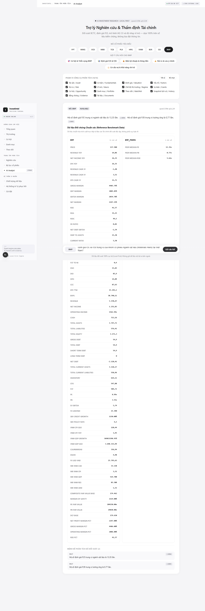

#### Rendered Prose Snippet
> Hệ số định giá P/E trung vị ngành vật liệu là 13,35 lần.  § E094  Hệ số định giá P/B trung vị tương ứng là 0,77 lần.  § E095...

#### Grounded Claims from DOM
- FACT
Hệ số định giá P/E trung vị ngành vật liệu là 13,35 lần.
§
E094
- FACT
Hệ số định giá P/B trung vị tương ứng là 0,77 lần.
§
E095

#### Uncertainty & Data Limitations from DOM
- *No ungrounded claims or uncertainties reported.*

---

### Q18_MWG_CCC_WorkingCapital — MWG: Chu kỳ tiền mặt CCC & Quản trị vốn lưu động

- **User Query:** "Chu kỳ chuyển đổi tiền mặt (Cash Conversion Cycle - CCC) và hiệu quả quản lý hàng tồn kho của MWG?"
- **Target Entity:** `MWG`
- **Inference Model:** `qwen3.5:9b-q4_K_M`
- **Total E2E Duration:** `49.69s`
- **Decision Status:** `AVAILABLE` (Expected: `AVAILABLE`)
- **Screenshot:** 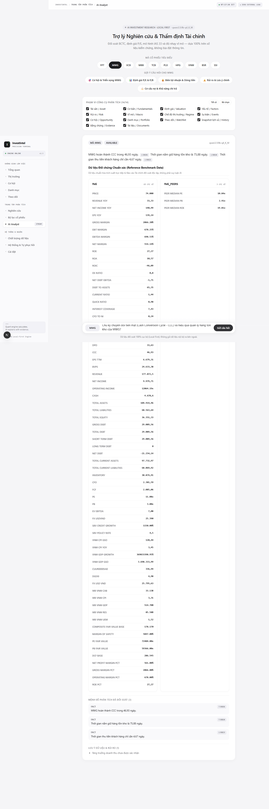

#### Rendered Prose Snippet
> MWG hoàn thành CCC trong 46,93 ngày.  § E026  Thời gian nắm giữ hàng tồn kho là 75,88 ngày.  § E024  Thời gian thu tiền khách hàng chỉ cần 4,67 ngày.  § E023...

#### Grounded Claims from DOM
- FACT
MWG hoàn thành CCC trong 46,93 ngày.
§
E026
- FACT
Thời gian nắm giữ hàng tồn kho là 75,88 ngày.
§
E024
- FACT
Thời gian thu tiền khách hàng chỉ cần 4,67 ngày.
§
E023

#### Uncertainty & Data Limitations from DOM
- ⚠️ Tăng trưởng doanh thu chưa được xác nhận

---

### Q19_ALL_Universe_Screener — Vũ trụ ALL: Bộ lọc cổ phiếu P/E < 15 và ROE > 15%

- **User Query:** "Các cổ phiếu thỏa mãn tiêu chí định giá rẻ P/E dưới 15 và sinh lời ROE trên 15%?"
- **Target Entity:** `ALL`
- **Inference Model:** `qwen3.5:9b-q4_K_M`
- **Total E2E Duration:** `83.74s`
- **Decision Status:** `AVAILABLE` (Expected: `AVAILABLE`)
- **Screenshot:** 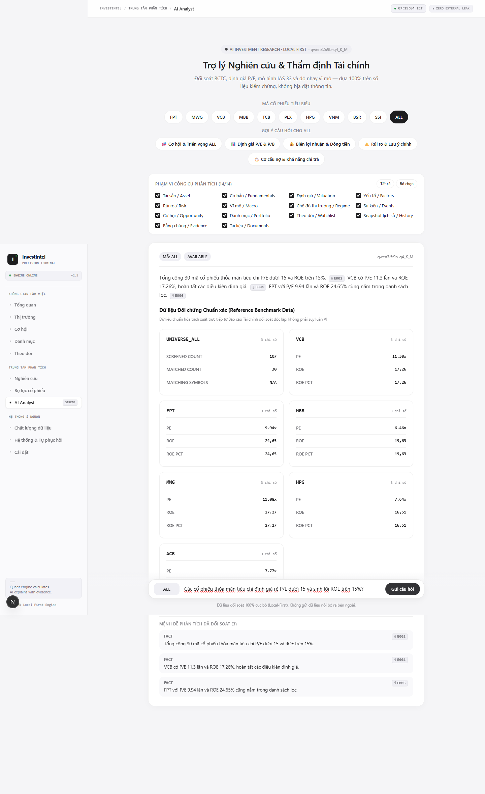

#### Rendered Prose Snippet
> Tổng cộng 30 mã cổ phiếu thỏa mãn tiêu chí P/E dưới 15 và ROE trên 15%.  § E002  VCB có P/E 11.3 lần và ROE 17.26%, hoàn tất các điều kiện định giá.  § E004  FPT với P/E 9.94 lần và ROE 24.65% cũng nằm trong danh sách lọc.  § E006...

#### Grounded Claims from DOM
- FACT
Tổng cộng 30 mã cổ phiếu thỏa mãn tiêu chí P/E dưới 15 và ROE trên 15%.
§
E002
- FACT
VCB có P/E 11.3 lần và ROE 17.26%, hoàn tất các điều kiện định giá.
§
E004
- FACT
FPT với P/E 9.94 lần và ROE 24.65% cũng nằm trong danh sách lọc.
§
E006

#### Uncertainty & Data Limitations from DOM
- *No ungrounded claims or uncertainties reported.*

---

