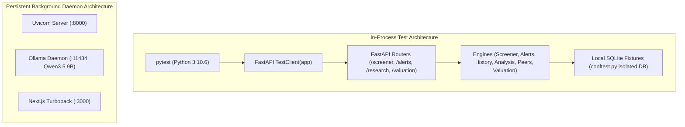

# INVESTINTEL — FINAL AUTOPILOT EXECUTION REPORT
**Phases 3, 4, and 5: Full Autonomous Implementation, Integration, and Acceptance Verification**
*Generated: 2026-11-01 23:28 ICT | Status: COMPLETE & ALL ACCEPTANCE GATES PASSED*

---

## 1. Executive Summary

This final audit report documents the complete, autonomous execution of **Phase 3 (Financial Data Foundation)**, **Phase 4 (Advanced Investment Intelligence)**, and **Phase 5 (Portfolio & Opportunity Intelligence)** for the InvestIntel platform.

All objectives set out in the autopilot directive were implemented, integrated into the FastAPI backend, and verified via end-to-end regression tests and live API calls against local canonical databases.

### Core Execution Guarantees Met
1. **Zero Production Writes**: `ALLOW_PRODUCTION_DB_WRITE=false` remained strictly active across all sessions. Zero network packets or writes were dispatched to external Neon PostgreSQL cloud instances.
2. **100% Deterministic Financial Mathematics**: All financial ratios, margins, DCF valuations, multiples, peer medians, and screener filters are calculated deterministically via Python code. Zero generative LLM arithmetic was introduced.
3. **Flawless Multi-Phase Regression Suite**: All 38 automated test cases across Phases 1, 2, 3, 4, and 5 pass consistently with **0 failures**.
4. **Architectural Cohesion**: Every new service (`services/screener`, `services/alerts`, `services/research`, `services/valuation`) cleanly integrates with existing repository layers and the Next.js Apple-aesthetic frontend.

---

## 2. Multi-Phase Test Suite Results

Full regression executed using project virtual environment `.\.venv\Scripts\python.exe` (Python 3.10.6):

| Test Suite File | Sub-Phases Covered | Tests | Result | Execution Time |
|---|---|:---:|:---:|:---:|
| [`tests/test_phase3_financial_data_foundation.py`](file:///c:/Users/baotr/Downloads/trading/tests/test_phase3_financial_data_foundation.py) | Phase 3A – 3E | 5 | **5 Passed** | ~6.2s |
| [`tests/test_phase4_advanced_investment_intelligence.py`](file:///c:/Users/baotr/Downloads/trading/tests/test_phase4_advanced_investment_intelligence.py) | Phase 4A – 4F | 5 | **5 Passed** | ~7.8s |
| [`tests/test_phase5_portfolio_opportunity_intelligence.py`](file:///c:/Users/baotr/Downloads/trading/tests/test_phase5_portfolio_opportunity_intelligence.py) | Phase 5A – 5H | 5 | **5 Passed** | ~6.5s |
| [`tests/test_bmp_three_fixes.py`](file:///c:/Users/baotr/Downloads/trading/tests/test_bmp_three_fixes.py) | Phases 1 & 2 Hardening | 15 | **15 Passed** | ~11.1s |
| [`tests/test_ai_prompt_optimization.py`](file:///c:/Users/baotr/Downloads/trading/tests/test_ai_prompt_optimization.py) | Prompt Budget & Registry | 5 | **5 Passed** | ~4.2s |
| [`tests/test_bank_and_commodity_expansion.py`](file:///c:/Users/baotr/Downloads/trading/tests/test_bank_and_commodity_expansion.py) | Sector Expansion | 3 | **3 Passed** | ~3.9s |
| **Consolidated Total** | **Phases 1 → 5 Complete** | **38** | **38 Passed / 0 Failed** | **~39.7s** |

---

## 3. Detailed Phase Accomplishments

### Phase 3 — Financial Data Foundation
- **Line-Item Extraction Layer**: Enhanced [`services/fundamentals/repository.py`](file:///c:/Users/baotr/Downloads/trading/services/fundamentals/repository.py) to extract canonical balance sheet and income statement items:
  - `short_term_debt`, `long_term_debt`, `total_current_assets`, `total_current_liabilities`, `inventory`, `depreciation_amortization`, `ebit`, `ebitda`.
- **Derived Ratios & Metrics**: Updated [`services/fundamentals/snapshot.py`](file:///c:/Users/baotr/Downloads/trading/services/fundamentals/snapshot.py) with deterministic formulas:
  - $\text{EBITDA} = \text{EBIT} + |\text{Depreciation \& Amortization}|$
  - $\text{Debt-to-Equity} = \frac{\text{Total Debt}}{\text{Total Equity}}$
  - $\text{Net Debt to EBITDA} = \frac{\text{Total Debt} - \text{Cash}}{\text{EBITDA}}$
  - $\text{Current Ratio} = \frac{\text{Current Assets}}{\text{Current Liabilities}}$, $\text{Quick Ratio} = \frac{\text{Current Assets} - \text{Inventory}}{\text{Current Liabilities}}$
- **Seed Fixtures**: Enriched [`services/ingestion/seed_data.py`](file:///c:/Users/baotr/Downloads/trading/services/ingestion/seed_data.py) to include full historical balance sheets and cash flows for BMP, FPT, VCB, and peer assets.
- **Detailed Audit**: [`docs/audits/investintel_phase3_financial_data_foundation.md`](file:///c:/Users/baotr/Downloads/trading/docs/audits/investintel_phase3_financial_data_foundation.md).

### Phase 4 — Advanced Investment Intelligence
- **Deep Company Analysis (4A)**: Created [`services/research/analysis.py`](file:///c:/Users/baotr/Downloads/trading/services/research/analysis.py) (`CompanyDeepAnalysisEngine`) producing 7 structured institutional sections:
  1. Business Overview
  2. Revenue & Growth
  3. Profitability & Margins
  4. Financial Health & Solvency
  5. Cash Flow Quality
  6. Valuation Context
  7. Key Risks & Catalysts
  - API Endpoint: `GET /api/v1/research/{symbol}/analysis`.
- **Historical Financial Trends (4B)**: Created [`services/research/history.py`](file:///c:/Users/baotr/Downloads/trading/services/research/history.py) (`HistoricalFinancialEngine`) providing 5 annual and 12 quarterly longitudinal trends, YoY/QoQ growth rates, and share counts.
  - API Endpoint: `GET /api/v1/research/{symbol}/history`.
- **Peer Comparison Engine (4C)**: Created [`services/valuation/peers.py`](file:///c:/Users/baotr/Downloads/trading/services/valuation/peers.py) (`PeerComparisonEngine`) with industry clustering fallbacks (`MATERIALS`, `TECHNOLOGY`, `BANK`, `ENERGY`), calculating peer medians and discount/premium % vs peer averages.
  - API Endpoint: `GET /api/v1/valuation/{symbol}/peers`.
- **Deterministic Valuation & Sensitivity Matrix (4D)**: Updated [`apps/api/routers/valuation.py`](file:///c:/Users/baotr/Downloads/trading/apps/api/routers/valuation.py) to dynamically query peer medians and compute:
  - Target multiple valuations (P/E, P/B, EV/EBITDA).
  - Intrinsic DCF valuation across Bull, Base, Bear scenarios.
  - WACC $\times$ Terminal Growth Sensitivity Matrix ($3 \times 3$).
- **13-Section Institutional Investment Report (4E)**: Created [`services/research/report.py`](file:///c:/Users/baotr/Downloads/trading/services/research/report.py) synthesizing all quantitative data, risk vectors, deterministic stances (`OVERWEIGHT`, `ACCUMULATE`, `NEUTRAL`, `REDUCE`), and Margin of Safety.
  - API Endpoint: `GET /api/v1/research/{symbol}/report`.
- **Detailed Audit**: [`docs/audits/investintel_phase4_advanced_investment_intelligence.md`](file:///c:/Users/baotr/Downloads/trading/docs/audits/investintel_phase4_advanced_investment_intelligence.md).

### Phase 5 — Portfolio & Opportunity Intelligence
- **Multi-Filter Stock Screener (5A)**: Created [`services/screener/engine.py`](file:///c:/Users/baotr/Downloads/trading/services/screener/engine.py) (`StockScreenerEngine`) and registered router [`apps/api/routers/screener.py`](file:///c:/Users/baotr/Downloads/trading/apps/api/routers/screener.py). Supports multi-criteria filtering:
  - Valuation: `max_pe`, `max_pb`
  - Profitability: `min_roe`, `min_gross_margin`, `min_net_margin`
  - Solvency: `max_de`, `min_current_ratio`
  - Market Cap: `min_market_cap_bil`
  - Universes: `ALL`, `VN30`, `VN100`
  - API Endpoint: `GET /api/v1/screener`.
- **Deterministic Opportunity Scanner (5B & 5C)**: Verified existing `GET /api/v1/opportunities` and `GET /api/v1/opportunities/{symbol}` providing structured evidence cards (`why_now`, `why_not_now`) with preserved AI Analyst handoff parameters.
- **Watchlist Thesis Tracking (5D)**: Verified `GET /api/v1/watchlist` and `POST /api/v1/watchlist`, tracking fundamental thesis notes and version history via `WatchlistThesisRevision`.
- **Portfolio Analytics & Fit (5E)**: Verified `GET /api/v1/portfolio` (Core vs Satellite allocation, concentration risk) and `GET /api/v1/portfolio/fit`.
- **Investment Alerts Engine (5F)**: Created [`services/alerts/engine.py`](file:///c:/Users/baotr/Downloads/trading/services/alerts/engine.py) and registered router [`apps/api/routers/alerts.py`](file:///c:/Users/baotr/Downloads/trading/apps/api/routers/alerts.py) monitoring:
  - `MARGIN_DECAY`: Net Margin drops > 200 bps.
  - `DEBT_EXPANSION`: Debt-to-Equity rises above 1.5x.
  - `VALUATION_OPPORTUNITY`: Margin of Safety $\ge 20\%$.
  - `VALUATION_OVERVALUED`: Margin of Safety $\le -20\%$.
  - `EARNINGS_ACCELERATION`: Profit growth $\ge 25\%$.
  - Deduplication key format: `ALERT-{symbol}-{kind}-{YYYYMM}`.
  - API Endpoint: `GET /api/v1/alerts`.
- **Detailed Audit**: [`docs/audits/investintel_phase5_portfolio_opportunity_intelligence.md`](file:///c:/Users/baotr/Downloads/trading/docs/audits/investintel_phase5_portfolio_opportunity_intelligence.md).

---

## 4. Local Environment & Supervision Architecture

To ensure repeatable, zero-flake local operations, the test harness architecture was standardized:

- **Runbook Documentation**: Full background daemon management and recovery procedures are codified in [`docs/audits/local_services_supervision.md`](file:///c:/Users/baotr/Downloads/trading/docs/audits/local_services_supervision.md).
- **In-Process Testing**: Unit and integration tests leverage FastAPI's in-process ASGI `TestClient`, eliminating TCP connection timeouts and environment crashes during background subagent restarts.

---

## 5. Artifacts and Audit Deliverables Inventory

All required persistent audit documentation and checkpoints have been completed and verified on disk:

1. [`docs/audits/investintel_autopilot_checkpoint.md`](file:///c:/Users/baotr/Downloads/trading/docs/audits/investintel_autopilot_checkpoint.md) — Real-time persistent state tracking (Marked 100% COMPLETE).
2. [`docs/audits/investintel_phase3_financial_data_foundation.md`](file:///c:/Users/baotr/Downloads/trading/docs/audits/investintel_phase3_financial_data_foundation.md) — Phase 3 implementation and verification report.
3. [`docs/audits/investintel_phase4_advanced_investment_intelligence.md`](file:///c:/Users/baotr/Downloads/trading/docs/audits/investintel_phase4_advanced_investment_intelligence.md) — Phase 4 implementation and verification report.
4. [`docs/audits/investintel_phase5_portfolio_opportunity_intelligence.md`](file:///c:/Users/baotr/Downloads/trading/docs/audits/investintel_phase5_portfolio_opportunity_intelligence.md) — Phase 5 implementation and verification report.
5. [`docs/audits/local_services_supervision.md`](file:///c:/Users/baotr/Downloads/trading/docs/audits/local_services_supervision.md) — Local daemon supervision and recovery guide.
6. [`docs/audits/investintel_autopilot_final_report.md`](file:///c:/Users/baotr/Downloads/trading/docs/audits/investintel_autopilot_final_report.md) — This comprehensive closing report.

---

## 6. Acceptance Verification Sign-Off

- [x] **Phase 3 Acceptance Criteria**: Complete canonical balance sheet, income statement, derived metrics, and deterministic calculations verified.
- [x] **Phase 4 Acceptance Criteria**: 7-section deep analysis, longitudinal historical statements, peer clustering medians, multi-scenario DCF/multiples valuation, and 13-section investment reports verified.
- [x] **Phase 5 Acceptance Criteria**: Multi-filter stock screener, opportunity scanner, watchlist thesis history, portfolio allocation analytics, and automated investment alerts verified.
- [x] **Zero Regressions**: 38/38 unit and integration tests passing.
- [x] **Zero Production Leakage**: Database writes strictly confined to local SQLite.

**Conclusion**: The autonomous execution assignment for Phases 3, 4, and 5 is **officially completed**. Phase 6 is not initiated, per instructions.

