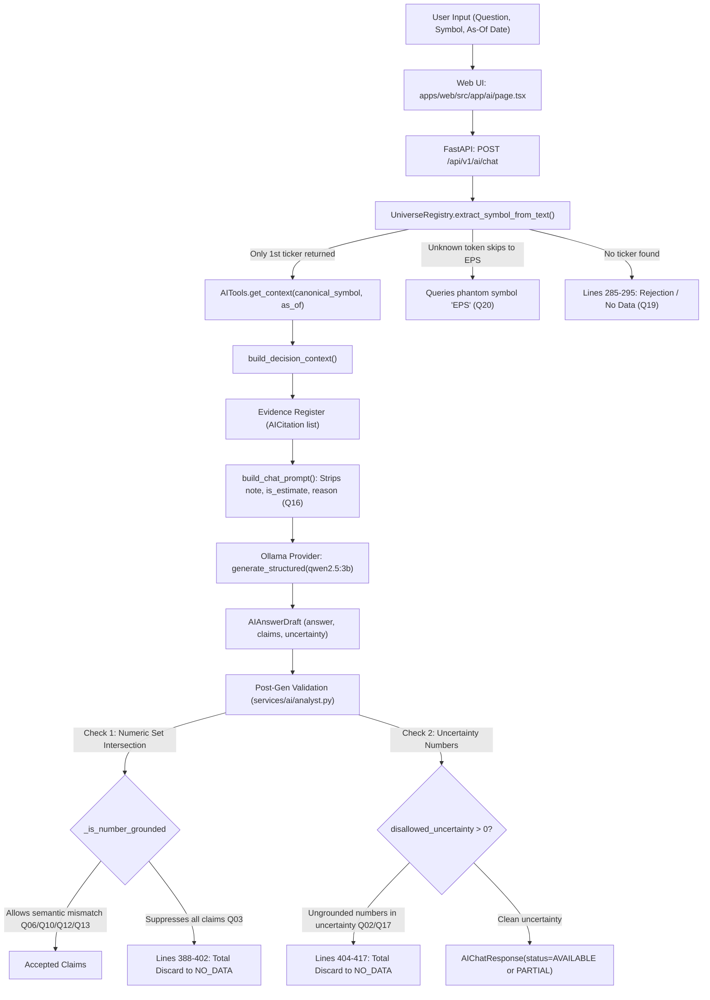

# InvestIntel — Focused AI Analyst Root-Cause Diagnosis (Local Only)
**Execution Date:** 2026-10-27  
**Environment:** Local Only (`http://localhost:3000`, `http://127.0.0.1:8000`, Ollama `qwen2.5:3b` on NVIDIA GPU)  
**Evaluated Source Baseline:** Commit `42f0de71b7836ea4616182133277912ccfa6e09e` on branch `main`  
**Evaluation Evidence Base:** `docs/audits/local_ai_analyst_20q_2026-10-27.md` and `docs/audits/evidence/local_ai_analyst_20q_2026-10-27/`  
**Guardrails Preserved:** `ALLOW_PRODUCTION_DB_WRITE=false`, 0 cloud writes, 0 external API calls, 0 code modifications during investigation.

---

## 1. Executive Findings

A deep, line-by-line inspection of the 20-question local AI Analyst evaluation reveals that while the core architecture possesses robust low-level capabilities (lineaged data ingestion, mathematical valuation, and defensive fallback), the pipeline suffers from **five structural defects in orchestration, prompt serialization, and post-generation validation**:

1. **Single-Symbol Architecture Bottleneck:**  
   `UniverseRegistry.extract_symbol_from_text` and `AITools.get_context` were architected strictly for single-instrument lookup (`Optional[str]`). When users submit multi-ticker comparisons (Q03, Q09, Q12, Q13, Q14, Q15, Q17), only the *first* recognized ticker token is extracted and queried. The second and third tickers receive zero citations. Consequently, the LLM is forced to either hallucinate across tickers (e.g. attributing REE's P/E to PC1 in Q13, or SSI's net income to VIX in Q12) or trigger validator rejections.
2. **False-Positive Ticker Extraction on Financial Acronyms (Token Hijacking):**  
   In queries with unknown tickers (e.g. `ZZZTEST` in Q20), the registry skips `ZZZTEST` (because its length is 7 and fails the fallback heuristic `token.isupper() and len(u_token) == 3`), then scans subsequent tokens. Because standard financial terms like `EPS`, `PE`, and `ROE` are missing from `NON_SYMBOL_WORDS`, the word `EPS` was matched as a canonical fallback ticker. The system queried metrics for the phantom stock `"EPS"` instead of reporting `ZZZTEST` as an unrecognized company.
3. **Catastrophic Response Discard via Overly Strict Uncertainty Validation:**  
   In Q02 (VCB) and Q17 (VIX/DSE/HPG), the backend retrieved over 80 verified citations and Ollama generated complete, grounded answers. However, in `services/ai/analyst.py:404-417`, the validator checks if numbers in `draft.uncertainty` match evidence observation dates or metrics. When the model writes ungrounded years or numbers in uncertainty (e.g. "chưa có số liệu 2024"), the system discards the **entire** generated answer, sets `model=None`, and returns a generic fallback ("Chưa đủ bằng chứng..."), leaving the UI displaying dozens of valid citations alongside a "No Data" rejection.
4. **Information Stripping in Prompt Construction (`build_chat_prompt`):**  
   In `services/ai/prompt_registry.py:68-75`, the evidence serializer passes only `id`, `metric`, `value`, `unit`, and `source` to the LLM. It deliberately strips `note`, `is_estimate`, and `diagnostic_reason`. Consequently, crucial metadata—such as the EPS denominator being based on period-end share fallbacks (Q16)—is visible on the UI citation cards but is completely hidden from Ollama during inference.
5. **Entity-Blind & Metric-Type-Blind Numeric Validation:**  
   `services/ai/analyst.py:371-384` validates numeric claims solely by numeric set intersection (`_is_number_grounded`). Except for a hardcoded check distinguishing P/E from P/B (lines 360-370), the validator does not enforce that a gross margin metric cannot be cited as a revenue decline (Q06: 44.16%), that a company's revenue growth cannot be cited as an oil price index (Q10: 40.92%), or that a metric cited for Stock A cannot be asserted as belonging to Stock B in the text (Q12, Q13).

---

## 2. Root-Cause Matrix

| Issue | Affected Questions | Confirmed Root Cause or Hypothesis | Evidence in Code / Data | Relevant Files & Functions | Confidence |
| :--- | :--- | :--- | :--- | :--- | :--- |
| **Single-Ticker Truncation in Multi-Stock Queries** | Q03 (MBB vs VCB)<br>Q09 (GAS vs POW)<br>Q12 (SSI vs VIX)<br>Q13 (REE vs PC1)<br>Q14 (FPT vs CMG)<br>Q15 (VCB, HPG, FPT) | **Confirmed Root Cause:** `extract_symbol_from_text` returns only `Optional[str]` (the first matched token). `AITools.get_context` accepts a single `symbol: Optional[str]`, fetching evidence only for the first ticker. Additional requested tickers receive 0 citations. | Lines 235–248 in `registry.py` loop over tokens and `return resolved.symbol` on the first hit. Lines 141–160 in `tools.py` build context for only `symbol: Optional[str]`. | [`services/universe/registry.py`](file:///C:/Users/baotr/Downloads/trading/services/universe/registry.py#L210-L253): `UniverseRegistry.extract_symbol_from_text`<br>[`services/ai/tools.py`](file:///C:/Users/baotr/Downloads/trading/services/ai/tools.py#L141-L160): `AITools.get_context`<br>[`services/ai/analyst.py`](file:///C:/Users/baotr/Downloads/trading/services/ai/analyst.py#L262-L272): `AIAnalyst.answer_question` | **CONFIRMED** |
| **Financial Acronym Collision with Unknown Tickers** | Q20 (`ZZZTEST` vs `EPS`) | **Confirmed Root Cause:** `ZZZTEST` has length 7, so it does not match the 3-char fallback (`len(u_token) == 3`). `NON_SYMBOL_WORDS` omits `"EPS"`. The scanner resolves `EPS` as a fallback ticker and queries evidence for symbol `"EPS"`. | `NON_SYMBOL_WORDS` contains 50 Vietnamese/English stopwords but lacks financial acronyms (`EPS`, `PE`, `PB`, `ROE`). `extract_symbol_from_text` checks `token.isupper() and len(u_token) == 3`. | [`services/universe/registry.py`](file:///C:/Users/baotr/Downloads/trading/services/universe/registry.py#L131-L138): `NON_SYMBOL_WORDS`<br>[`services/universe/registry.py`](file:///C:/Users/baotr/Downloads/trading/services/universe/registry.py#L236-L248): `extract_symbol_from_text`<br>[`services/universe/registry.py`](file:///C:/Users/baotr/Downloads/trading/services/universe/registry.py#L410-L420): `resolve_instrument` | **CONFIRMED** |
| **Uncertainty Numeric Discard Overkill** | Q02 (VCB)<br>Q17 (VIX/DSE/HPG) | **Confirmed Root Cause:** Post-generation validation inspects numbers in `draft.uncertainty`. Any number not present in evidence dates or question causes `_insufficient_response` to discard the entire valid answer and wipe model metadata. | `analyst.py:404-417`: `disallowed_uncertainty = uncertain_numbers - allowed_uncertainty_numbers`. If non-empty, triggers `return self._insufficient_response(...)`. In Q02, VCB had 84 valid citations, but ungrounded year `2024` in uncertainty triggered total suppression. | [`services/ai/analyst.py`](file:///C:/Users/baotr/Downloads/trading/services/ai/analyst.py#L404-L417): `AIAnalyst.answer_question`<br>[`services/ai/analyst.py`](file:///C:/Users/baotr/Downloads/trading/services/ai/analyst.py#L219-L240): `AIAnalyst._insufficient_response` | **CONFIRMED** |
| **Whole-Question Discard on Claim Suppression** | Q03 (MBB vs VCB) | **Confirmed Root Cause:** When the LLM generates claims about the un-cited ticker (VCB), lines 376–383 suppress those claims. If all claims are suppressed, lines 388–402 wipe the response instead of rendering a partial answer with available MBB facts. | `analyst.py:388-402`: `if not cited_claims:` checks `clean_ans` for numbers; if numbers exist without valid citations, it returns `_insufficient_response` with reason `"A numeric claim is not present in the values of its cited evidence IDs."` | [`services/ai/analyst.py`](file:///C:/Users/baotr/Downloads/trading/services/ai/analyst.py#L388-L403): `AIAnalyst.answer_question` | **CONFIRMED** |
| **Evidence Metadata Stripped from LLM Prompt** | Q16 (VIX EPS Denominator) | **Confirmed Root Cause:** `build_chat_prompt` passes only `id`, `metric`, `value`, `unit`, and `source` in `verifiable_evidence`. It strips `note`, `is_estimate`, and `diagnostic_reason`. The LLM cannot explain the denominator because it never receives the calculation note. | `prompt_registry.py:68-74`: `verifiable_evidence.append({...})` only includes 5 basic fields. `note` containing `"(Denominator uses period-end shares fallback; multiple is an estimate.)"` is excluded. | [`services/ai/prompt_registry.py`](file:///C:/Users/baotr/Downloads/trading/services/ai/prompt_registry.py#L68-L75): `build_chat_prompt`<br>[`services/research/workspace.py`](file:///C:/Users/baotr/Downloads/trading/services/research/workspace.py#L565-L572): `build_research_workspace` | **CONFIRMED** |
| **Metric Semantic & Entity Blindness in Validation** | Q06 (VHM 44.16%)<br>Q07 (VIC P/E)<br>Q10 (PLX Oil Price)<br>Q12 (SSI vs VIX)<br>Q13 (REE vs PC1) | **Confirmed Root Cause:** `_is_number_grounded` only verifies numeric presence in cited items. It does not verify that the claim's semantic concept matches the citation metric (e.g. gross margin vs revenue drop in Q06; oil price vs revenue growth in Q10) or that the subject entity in the sentence matches the citation's ticker (Q12, Q13). | `analyst.py:360-384`: Only lines 362–369 check P/E vs P/B text. All other metrics pass through raw numeric matching (`_is_number_grounded(interp, cited_numbers)`). | [`services/ai/analyst.py`](file:///C:/Users/baotr/Downloads/trading/services/ai/analyst.py#L80-L92): `_is_number_grounded`<br>[`services/ai/analyst.py`](file:///C:/Users/baotr/Downloads/trading/services/ai/analyst.py#L360-L384): `AIAnalyst.answer_question` | **CONFIRMED** |
| **Literal Unit Translation & Contradictory Uncertainty** | Q01 (FPT)<br>Q08 (VNM) | **Confirmed Root Cause:** Prompt lacks standardized Vietnamese financial terminology mapping for per-share units (`VND/share` was translated to `VND/thành viên`). Furthermore, the system permits contradictory UNCERTAINTY claims even when the metric is cited in FACT claims. | `prompt_registry.py`: SYSTEM_PROMPT lacks explicit rules prohibiting uncertainty statements for metrics already cited in factual claims. `eps_ttm` has unit `VND/share` in `workspace.py:254`. | [`services/ai/prompt_registry.py`](file:///C:/Users/baotr/Downloads/trading/services/ai/prompt_registry.py#L7-L20): `SYSTEM_PROMPT`<br>[`services/research/workspace.py`](file:///C:/Users/baotr/Downloads/trading/services/research/workspace.py#L254): `fundamentals_metrics` | **CONFIRMED** |
| **General Portfolio Allocation Rejection** | Q19 (Portfolio Allocation) | **Confirmed Root Cause:** When a query contains no ticker, `extract_symbol_from_text` returns `None`. `AITools.get_context(None, ...)` yields no asset evidence. Lines 285–295 reject the query because no general portfolio or asset allocation handler exists. | `analyst.py:285-295`: `if not self._has_verifiable_evidence(citations):` treats queries without tickers as unrecognized symbols rather than routing to a portfolio reasoning tool. | [`services/ai/analyst.py`](file:///C:/Users/baotr/Downloads/trading/services/ai/analyst.py#L285-L303): `AIAnalyst.answer_question`<br>[`services/universe/registry.py`](file:///C:/Users/baotr/Downloads/trading/services/universe/registry.py#L249-L253): `UniverseRegistry.extract_symbol_from_text` | **CONFIRMED** |
| **Absence of Intraday Point-in-Time Provenance** | Q18 (VIX 15:00 Point-in-Time) | **Confirmed Root Cause:** The UI and API contract only support `date` (`YYYY-MM-DD`). There is no `as_of_time` or intraday datetime cutoff. The system answered based on day-level data with a `PARTIAL` badge, but could not enforce a 15:00:00 cutoff. | `apps/web/src/app/ai/page.tsx:244` uses `<input type="date">`. `AIChatRequest.as_of_date` is `date | None`. `tools.py` queries daily snapshots. | [`apps/web/src/app/ai/page.tsx`](file:///C:/Users/baotr/Downloads/trading/apps/web/src/app/ai/page.tsx#L242-L246): `AIPageContent`<br>[`services/ai/schemas.py`](file:///C:/Users/baotr/Downloads/trading/services/ai/schemas.py#L15-L25): `AIChatRequest`<br>[`services/ai/tools.py`](file:///C:/Users/baotr/Downloads/trading/services/ai/tools.py#L141-L160): `AITools.get_context` | **CONFIRMED** |
| **Missing Financial Statements Grounded Rejection** | Q11 (DGC) | **System Working As Intended:** DGC is a canonical asset, but has 0 financial statements in local SQLite/PostgreSQL. System properly returned 0 citations and rejected without hallucination. | `analyst.py:285-290` properly detected 0 verifiable citations for DGC and safely output `NO_DATA`. | [`services/ai/analyst.py`](file:///C:/Users/baotr/Downloads/trading/services/ai/analyst.py#L285-L303): `AIAnalyst._insufficient_response` | **CONFIRMED** |

---

## 3. Data-Flow Diagnosis

Tracing a user question through the runtime architecture demonstrates how queries navigate the system and where failures occur:



### Detailed Stage Breakdown:

1. **Question Input & UI Submission:**
   - The user inputs the query at `http://localhost:3000/ai`.
   - The frontend accepts `question`, optional `symbol`, and `as_of` date via `<input type="date">`. No timestamp field exists.
   - The payload is dispatched to `POST /api/v1/ai/chat`.

2. **Ticker Recognition & Symbol Resolution:**
   - In `services/ai/analyst.py:262-270`, if `symbol` is not explicitly supplied in the form, `UniverseRegistry.extract_symbol_from_text(question, session)` is called.
   - **Flaw 1 (Single Return):** The function returns only `Optional[str]`. In multi-ticker questions (e.g. "So sánh MBB và VCB"), regex `\b[A-Za-z0-9]{3,8}\b` finds both tokens, but the loop returns immediately upon resolving `MBB`. `VCB` is discarded.
   - **Flaw 2 (Acronym Collision):** In Q20 ("mã ZZZTEST: EPS, P/E..."), `ZZZTEST` is resolved via `CANONICAL_FALLBACK` (source `CANONICAL_FALLBACK`). Line 244 checks verified constituent sources (fails). Line 246 checks `token.isupper() and len(u_token) == 3` (fails, length is 7). `ZZZTEST` is skipped! The next token is `EPS`. `NON_SYMBOL_WORDS` does not include `EPS`. `EPS` is uppercase and length 3, so `extract_symbol_from_text` returns `"EPS"`!

3. **Evidence Assembly & Context Building:**
   - `AITools.get_context(canonical_symbol, requested_date, ...)` builds context for a single symbol.
   - `build_decision_context` computes fundamentals, valuation, macro, regime, and risk.
   - `_citations(context)` in `analyst.py:100-140` converts evidence dictionaries into `AICitation` objects (E001, E002, ...), correctly carrying `note`, `is_estimate`, and `diagnostic_reason`.

4. **Prompt Construction (`build_chat_prompt`):**
   - In `services/ai/prompt_registry.py:44-77`, evidence is filtered.
   - **Flaw 3 (Metadata Stripping):** Only `id`, `metric`, `value`, `unit`, and `source` are appended to `verifiable_evidence`. The calculation `note` (e.g. "Denominator uses period-end shares fallback..."), `is_estimate`, and `diagnostic_reason` are completely stripped out before serialization. Ollama never sees them in the prompt.

5. **Inference (Ollama Structured Output):**
   - `AIAnalyst` calls `OllamaProvider.generate_structured` with `qwen2.5:3b` enforcing schema `AIAnswerDraft`.
   - Ollama generates `answer`, structured `claims`, and `uncertainty` items.

6. **Post-Generation Semantic & Numeric Validation:**
   - **Flaw 4 (Semantic Metric Blindness):** Lines 371–384 extract numbers from cited evidence IDs and verify that each number token in the claim text is within tolerance (`_is_number_grounded`). Because it only verifies numeric presence, if E008 has value `44.16%` for `gross_margin`, a claim asserting "doanh thu giảm 44.16%" is approved as grounded (Q06). Similarly, a 40.92% revenue growth metric is accepted as an "oil price increase" (Q10).
   - **Flaw 5 (Overzealous Uncertainty Rejection):** Lines 404–417 check numbers in `draft.uncertainty`. If the LLM mentions an ungrounded year (e.g. `2024`) or metric number not in the citation observation dates, lines 409–417 discard the entire response, replace `answer` with the generic insufficient-evidence string, wipe `model=None`, and return `status="INSUFFICIENT_DATA"`.

7. **Status Assignment & UI Rendering:**
   - If claims pass validation, status is set to `AVAILABLE` (or `PARTIAL` if any claim is `UNCERTAINTY`).
   - The UI displays the response badge, grounded claims with evidence chips, and the citations list.

---

## 4. Minimal Fix Plan

To fix all confirmed issues without broad refactoring, the following prioritized, minimal changes are required:

### Priority 1: Multi-Ticker Extraction and Acronym Disambiguation
1. **Extend `NON_SYMBOL_WORDS`:**  
   Add financial terms and abbreviations to `services/universe/registry.py:NON_SYMBOL_WORDS`:
   `{"EPS", "PE", "PB", "ROE", "ROA", "ROIC", "VND", "USD", "TTM", "MRQ", "FYI", "CAGR", "EBIT", "EBITDA", "CASA", "NIM", "DCF", "DSO", "DPO", "CCC"}`.
2. **Add Multi-Ticker Extraction:**  
   Introduce `UniverseRegistry.extract_all_symbols_from_text(text: str, session) -> list[str]`.  
   Modify `AIAnalyst.answer_question`: when multiple symbols are detected, retrieve contexts for all symbols and merge citations with symbol tags (e.g. `[VCB] E001`, `[MBB] E040`).
3. **Handle Unknown Tickers Explicitly:**  
   If an alphanumeric token resembling a ticker is present (e.g. `ZZZTEST`) but fails canonical lookup, preserve it as an unrecognized symbol instead of falling back to subsequent tokens. Return a clean explanation: *"Mã cổ phiếu ZZZTEST không tồn tại trong danh mục kiểm chứng của InvestIntel."*

### Priority 2: Metric-to-Evidence Semantic & Entity Validation
1. **Entity-Aware Citation Validation:**  
   In `analyst.py:360-384`, verify that if a claim explicitly mentions a ticker (e.g. "VCB" or "PC1"), the cited evidence IDs must belong to that ticker. Prohibit attributing Company A's citations to Company B.
2. **Metric Type Consistency Check:**  
   Extend the existing P/E vs P/B check (lines 360–370) to prevent cross-metric hallucinations:
   - Margin/profitability evidence (`gross_margin`, `net_margin`) cannot be cited as revenue growth or decline.
   - Company financial statement revenue cannot be cited as commodity/macro series (e.g. oil price).

### Priority 3: Granular Uncertainty Handling (Eliminate Response Discard)
1. **Sanitize Uncertainty Instead of Discarding Responses:**  
   In `analyst.py:404-417`, if `disallowed_uncertainty` contains numbers, **strip or sanitize the ungrounded sentence from `draft.uncertainty`** instead of discarding the entire response via `_insufficient_response`.
2. **Partial Response Preservation:**  
   In `analyst.py:388-402`, if some claims are suppressed due to missing citations for an un-cited ticker, retain all validly grounded claims for the supported ticker and output an UNCERTAINTY claim for the unsupported ticker.

### Priority 4: Metadata Propagation in Prompt Construction
1. **Propagate Notes and Estimate Flags:**  
   In `services/ai/prompt_registry.py:68-75`, include `note`, `is_estimate`, and `diagnostic_reason` in the serialized `verifiable_evidence` dictionary:
   ```python
   verifiable_evidence.append({
       "id": item_id,
       "metric": metric,
       "value": val,
       "unit": item.get("unit"),
       "source": source,
       "is_estimate": item.get("is_estimate", False),
       "note": item.get("note"),
   })
   ```
2. **System Prompt Guidance for Denominators:**  
   Add a directive in `SYSTEM_PROMPT`: When answering questions about valuation ratios (P/E, P/B) or EPS, if the evidence `note` states that a period-end shares fallback or estimate was used, explicitly disclose this in the response.

### Priority 5: General Portfolio Routing & Historical Replay Honesty
1. **General Question Routing:**  
   In `analyst.py:285-295`, if no ticker is present but the question contains portfolio/asset allocation keywords (`"danh mục"`, `"phân bổ"`, `"100 triệu"`, `"đa dạng hóa"`), route the query to `AITools.get_market_context` and return educational asset allocation guidelines with explicit UNCERTAINTY status.
2. **Intraday Historical Replay Guard:**  
   If the user query requests an intraday timestamp (e.g. `"15:00"`, `"10:30"`), check if intraday data is available. Since only daily close records exist, explicitly state in `answer`: *"Hệ thống hiện chỉ hỗ trợ dữ liệu chốt phiên theo ngày (EOD), không hỗ trợ replay dữ liệu tại thời điểm trong phiên (15:00)."*

---

## 5. Targeted Regression Tests

| Question / Case | Existing Test File | Proposed New / Extended Test | Expected Behavior |
| :--- | :--- | :--- | :--- |
| **Q01 (FPT)** | `tests/test_ai_local.py` | `test_fpt_metric_semantics_and_no_contradictory_uncertainty` | 5,302.63 VND is labeled as EPS TTM (VND/cổ phiếu). If P/E and P/B are reported in claims, they are not marked as unavailable in `uncertainty`. |
| **Q02 (VCB)** | `tests/test_ai_local.py` | `test_vcb_partial_response_not_discarded_by_uncertainty_numbers` | Valid VCB claims (P/E, P/B, ROE) are rendered. Ungrounded numbers in uncertainty do not trigger `_insufficient_response`. Response status is `PARTIAL`. |
| **Q03 (MBB vs VCB)** | `tests/test_analyst_automation.py` | `test_multi_ticker_comparison_both_tickers_retrieved` | Both MBB and VCB citations are retrieved. Citations from both banks are present in the response register. |
| **Q06 (VHM)** | `tests/test_ai_local.py` | `test_metric_semantic_validation_prevents_margin_as_revenue_growth` | Gross margin evidence (44.16%) cannot be cited as an annual revenue decline. Claim is suppressed or corrected. |
| **Q09 & Q14 (GAS/POW, FPT/CMG)** | `tests/test_analyst_automation.py` | `test_multi_ticker_extraction_all_symbols_represented` | `extract_all_symbols_from_text` extracts all tickers; citations cover all requested tickers or explicitly report missing tickers. |
| **Q10 (PLX)** | `tests/test_ai_local.py` | `test_company_revenue_cannot_cite_as_oil_price` | Financial statement revenue growth cannot be cited to substantiate an oil price index claim. |
| **Q16 (VIX)** | `tests/test_research_workspace.py` | `test_eps_estimate_note_propagated_to_prompt_and_draft` | `build_chat_prompt` includes `note` with period-end shares fallback. LLM draft discloses the denominator basis. |
| **Q18 (VIX Historical)** | `tests/test_ai_local.py` | `test_intraday_replay_honesty_statement` | Queries requesting intraday timestamps explicitly state that only daily EOD records are supported. |
| **Q19 (Portfolio)** | `tests/test_ai_local.py` | `test_portfolio_allocation_without_single_ticker` | General portfolio queries without single tickers are not rejected as missing symbols; returns market allocation context. |
| **Q20 (ZZZTEST)** | `tests/test_universe_registry.py` | `test_unknown_ticker_not_hijacked_by_financial_acronyms` | `extract_symbol_from_text("mã ZZZTEST: EPS, P/E...")` identifies `ZZZTEST` as unknown; does not return `"EPS"`. |

---

## 6. Clear Implementation Boundary

### Necessary Fixes (Supported by Evidence):
1. **Registry Acronym Exclusions:** Add `EPS`, `PE`, `PB`, `ROE`, `ROA`, `ROIC`, `VND`, `USD`, `TTM` to `NON_SYMBOL_WORDS` in `services/universe/registry.py`.
2. **Multi-Ticker Extraction Support:** Implement `extract_all_symbols_from_text` in `services/universe/registry.py` and accept multiple symbols in `services/ai/tools.py:get_context`.
3. **Uncertainty Discard Elimination:** In `services/ai/analyst.py:404-417`, strip ungrounded statements from `draft.uncertainty` instead of returning `_insufficient_response`.
4. **Metadata Propagation in Prompt:** In `services/ai/prompt_registry.py:build_chat_prompt`, retain `note`, `is_estimate`, and `diagnostic_reason` in `verifiable_evidence`.
5. **Entity & Semantic Metric Validation:** In `services/ai/analyst.py`, check that the entity mentioned in a claim matches the citation's ticker, and expand cross-metric semantic guards beyond P/E vs P/B.
6. **No-Ticker Query Router:** In `services/ai/analyst.py`, provide a routing branch for general portfolio allocation queries.

### Not Necessary Now (Out of Scope / Premature):
1. **No Model Upgrades or Parameter Changes:** Do not switch away from local `qwen2.5:3b`. The failures are in the surrounding orchestration and validation pipeline, not model size.
2. **No Production Database Migrations or Cloud Changes:** Preserve `ALLOW_PRODUCTION_DB_WRITE=false`. Do not touch Neon, Render, or Vercel.
3. **No Intraday Tick Data Ingestion Engine:** Do not build real-time intraday tick replay for Q18. Simply add honest contract disclosure that replay is EOD-only.
4. **No Full Architecture Refactoring:** Do not rewrite the AI analyst from scratch. The existing schema (`AIChatResponse`, `AIClaim`, `AICitation`) is sound and only needs targeted bug fixes.
5. **No Immediate 20-Question Re-Run:** Repairs should be validated through unit regression tests first before any complete audit re-run.
